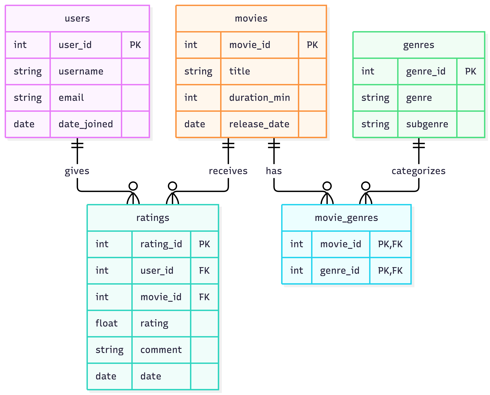

# ex603-movie-tv-database

A platform where users can browse movies and submit their ratings. 

Name: Isabella Boulais  
Theme: Movie/Tv  

## Domain

This platform allows users to discover and evaluate movies. Users cna view available movies and see information such as titles, duration, release date, and average rating scored by other users on the platform. They can also explore different genres and associated movies. Users can submit or update ratings on movies, which will update the average score. 

This platform will answer questions about movie characteristics such as which movies belong to a specific genre, how it is rated by other users, and how many users have rated that movie. It will also answer more in-depth questions such as what genres have the highest rated movies and which movies have gained the most ratings.

## Entity Relationship Diagram



## Schema — summarize the five roles and your key design decisions.

The 5 roles are: users, movies, ratings, genres, and movie_genres. Users holds account information such as username, email, and date joined. Movies holds data unique to the movie such as title, duration, and release date. The ratings table connects a user to the movie they rate with foreign keys for user_id and movie_id as well as the actual rating value. The genres table holds unique genre names and optional lists of subgenres. Lastly, the movie_genres defines the relationship between a movie and its genres with a foreign key for the genre_id and movie_id.

I decided to delete a users rating when their user account is deleted to respect data privacy and ensure integrity. If a user recereates their account and makes a rating on a movie they rated on their old account, this allows 1 user to have multiple ratings for a movie, which violates the rule that one user can rate a movie once, enforced by the UNIQUE(user_id, movie_id) constraint.

# To fill in later:

## Query catalogue

#### 4.1.1

What are the overall rating count, score total, average, minimum, maximum, and number of distinct users? ([query file](queries/unit4/q4_1.sql))

```sql
SELECT COUNT(*) AS count_ratings,
       SUM(score) AS total,
       AVG(score) AS average,
       MIN(score) AS minimum,
       MAX(score) AS maximum,
       COUNT(DISTINCT user_id) AS count_users
FROM ratings;
```

#### 4.1.2

Which movies receive the most ratings, and what is each movie's average score? ([query file](queries/unit4/q4_1.sql))

```sql
SELECT movie_id,
       COUNT(*) AS ratings_count,
       ROUND(AVG(score), 2) AS average_score
FROM ratings
GROUP BY movie_id
ORDER BY ratings_count DESC;
```

#### 4.1.3

Which movies have more than 15 ratings, and what are their average scores? ([query file](queries/unit4/q4_1.sql))

```sql
SELECT movie_id,
       COUNT(*) AS ratings_count,
       ROUND(AVG(score), 2) AS average_score
FROM ratings
GROUP BY movie_id
HAVING COUNT(*) > 15
ORDER BY ratings_count DESC;
```

#### 4.1.4

How do rating volume and score summaries vary by movie and user region? ([query file](queries/unit4/q4_1.sql))

```sql
SELECT movie_id,
       device_country AS region,
       COUNT(*) AS ratings_count,
       ROUND(AVG(score), 2) AS average_score,
       MIN(score) AS minimum_score,
       MAX(score) AS maximum_score,
       COUNT(DISTINCT user_id) AS distinct_users
FROM ratings
GROUP BY movie_id, device_country;
```

#### 4.2 Part A

For each movie, how many ratings are there, and how many were withdrawn? ([query file](queries/unit4/q4_2.sql))

```sql
SELECT movie_id,
       COUNT(*) AS ratings_count,
       SUM(CASE WHEN rating_status = 'withdrawn' THEN 1 ELSE 0 END) AS failure_count
FROM ratings
GROUP BY movie_id
ORDER BY failure_count DESC, movie_id;
```

#### 4.2 Part B

How many ratings come from each region, and what is the platform-wide total? ([query file](queries/unit4/q4_2.sql))

```sql
SELECT device_country AS region,
       COUNT(*) AS ratings_count
FROM ratings
GROUP BY ROLLUP (device_country)
ORDER BY device_country NULLS LAST;
```

#### 4.2 Part C

Which movies have more distinct rating users than the average across movies? ([query file](queries/unit4/q4_2.sql))

```sql
WITH movie_user_counts AS (
    SELECT movie_id,
           COUNT(DISTINCT user_id) AS distinct_ratings
    FROM ratings
    GROUP BY movie_id
),
summary AS (
    SELECT AVG(distinct_ratings) AS avg_ratings
    FROM movie_user_counts
)
SELECT m.movie_id,
       m.distinct_ratings
FROM movie_user_counts AS m
CROSS JOIN summary AS s
WHERE m.distinct_ratings > s.avg_ratings;
```

## Technical highlights — three to five things a reader should notice.

## What I would do differently — an honest paragraph. Critiquing your own work is a senior signal, not a weakness.

## Video presentation — embed or link the video.

## How to run it — the commands to create the schema and execute a query. Assume the reader has a database and nothing else.
