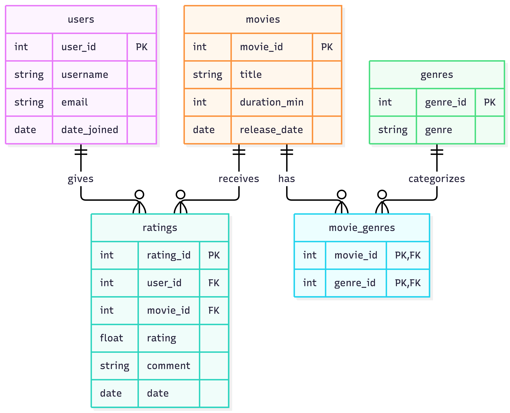

# ex603-movie-tv-database

A platform where users can browse movies and submit their ratings. 

Name: Isabella Boulais  
Theme: Movie/Tv  

## Domain

This platform allows users to discover and evaluate movies. Users cna view available movies and see information such as titles, duration, release date, and average rating scored by other users on the platform. They can also explore different genres and associated movies. Users can submit or update ratings on movies, which will update the average score. 

This platform will answer questions about movie characteristics such as which movies belong to a specific genre, how it is rated by other users, and how many users have rated that movie. It will also answer more in-depth questions such as what genres have the highest rated movies and which movies have gained the most ratings.

## Entity Relationship Diagram

## Schema — summarize the five roles and your key design decisions.

The 5 roles are: users, movies, ratings, genres, and movie_genres. Users holds account information such as username, email, and date joined. Movies holds data unique to the movie such as title, duration, and release date. The ratings table connects a user to the movie they rate with foreign keys for user_id and movie_id as well as the actual rating value. The genres table holds the genre names from a pre-determined list of available genre titles. Lastly, the movie_genres defines the relationship between a movie and its genres with a foreign key for the genre_id and movie_id. 

I decided to delete a users rating when their user account is deleted to respect data privacy and ensure integrity. If a user recereates their account and makes a rating on a movie they rated on their old account, this allows 1 user to have multiple ratings for a movie, which violates the rule that one user can rate a movie once, enforced by the UNIQUE(user_id, movie_id) constraint. Additionally, I decided to add a check on the genre name and create a predefined list of valid names. This ensures we are able to accurately search the database for movie genres and we won't miss data because of misspellings or abbreviations. 

# To fill in later:

## Query catalogue — per unit, a short table listing the queries and the business question each answers, linked to the .sql files.

## Technical highlights — three to five things a reader should notice.

## What I would do differently — an honest paragraph. Critiquing your own work is a senior signal, not a weakness.

## Video presentation — embed or link the video.

## How to run it — the commands to create the schema and execute a query. Assume the reader has a database and nothing else.
