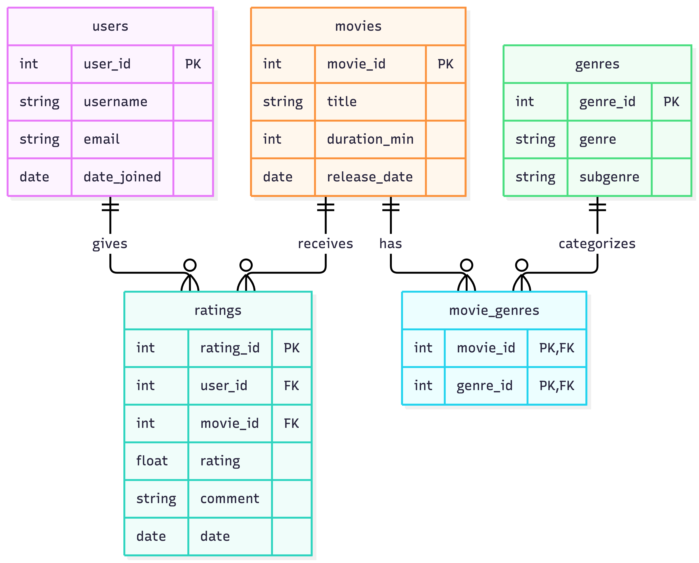

# ex603-movie-tv-database

A platform where users can browse movies and submit their ratings. 

Name: Isabella Boulais  
Theme: Movie/Tv  

## Domain

This platform allows users to discover and evaluate movies. Users cna view available movies and see information such as titles, duration, release date, and average rating scored by other users on the platform. They can also explore different genres and associated movies. Users can submit or update ratings on movies, which will update the average score. 

This platform will answer questions about movie characteristics such as which movies belong to a specific genre, how it is rated by other users, and how many users have rated that movie. It will also answer more in-depth questions such as what genres have the highest rated movies and which movies have gained the most ratings.

## Entity Relationship Diagram



## Schema

The 5 roles are: users, movies, ratings, genres, and movie_genres. Users holds account information such as username, email, and date joined. Movies holds data unique to the movie such as title, duration, and release date. The ratings table connects a user to the movie they rate with foreign keys for user_id and movie_id as well as the actual rating value. The genres table holds unique genre names and optional lists of subgenres. Lastly, the movie_genres defines the relationship between a movie and its genres with a foreign key for the genre_id and movie_id.

I decided to delete a users rating when their user account is deleted to respect data privacy and ensure integrity. If a user recereates their account and makes a rating on a movie they rated on their old account, this allows 1 user to have multiple ratings for a movie, which violates the rule that one user can rate a movie once, enforced by the UNIQUE(user_id, movie_id) constraint.

## Query catalogue

| Unit | Business question | SQL file |
|---|---|---|
| 3.1 | Filter recent available movies and explore rating statuses, scores, reasons, and rating categories. | [Unit 3.1 queries](queries/unit3/q3_1.sql) |
| 3.2 | Compare rating results and handle aliases and column references correctly. | [Unit 3.2 queries](queries/unit3/q3_2.sql) |
| 3.3 | Find flagged or withdrawn ratings and identify patterns across users and movies. | [Unit 3.3 queries](queries/unit3/q3_3.sql) |
| 4.1 | Summarize platform and movie rating counts, totals, averages, minimums, maximums, and distinct users. | [Unit 4.1 queries](queries/unit4/q4_1.sql) |
| 4.2 | Measure withdrawn ratings, regional subtotals, and movies above the average distinct-user count. | [Unit 4.2 queries](queries/unit4/q4_2.sql) |
| 5.1 | Connect users, movies, genres, and ratings, and compare related records. | [Unit 5.1 queries](queries/unit5/q5_1.sql) |
| 5.2 | Compare join types and identify movies that have never received ratings. | [Unit 5.2 queries](queries/unit5/q5_2.sql) |
| 5.3 | Examine join performance and the PostgreSQL execution plan. | [Unit 5.3 queries](queries/unit5/q5_3.sql) |
| 6.1 | Compare each rating with its movie average and rank or band movies. | [Unit 6.1 queries](queries/unit6/q6_1.sql) |
| 6.2 | Compare neighboring ratings, running totals, moving averages, and gaps. | [Unit 6.2 queries](queries/unit6/q6_2.sql) |
| 6.3 | Return top ratings per movie and compare monthly performance. | [Unit 6.3 queries](queries/unit6/q6_3.sql) |

The detailed Unit 4 results are shown below.

#### 4.1.1

What are the overall rating count, score total, average, minimum, maximum, and number of distinct users? ([query file](queries/unit4/q4_1.sql))

```sql
SELECT COUNT(*) AS count_ratings,
       SUM(score) AS total,
       AVG(score) AS average,
       MIN(score) AS minimum,
       MAX(score) AS maximum,
       COUNT(DISTINCT user_id) AS count_users
FROM ratings;
```

#### 4.1.2

Which movies receive the most ratings, and what is each movie's average score? ([query file](queries/unit4/q4_1.sql))

```sql
SELECT movie_id,
       COUNT(*) AS ratings_count,
       ROUND(AVG(score), 2) AS average_score
FROM ratings
GROUP BY movie_id
ORDER BY ratings_count DESC;
```

#### 4.1.3

Which movies have more than 15 ratings, and what are their average scores? ([query file](queries/unit4/q4_1.sql))

```sql
SELECT movie_id,
       COUNT(*) AS ratings_count,
       ROUND(AVG(score), 2) AS average_score
FROM ratings
GROUP BY movie_id
HAVING COUNT(*) > 15
ORDER BY ratings_count DESC;
```

#### 4.1.4

How do rating volume and score summaries vary by movie and user region? ([query file](queries/unit4/q4_1.sql))

```sql
SELECT movie_id,
       device_country AS region,
       COUNT(*) AS ratings_count,
       ROUND(AVG(score), 2) AS average_score,
       MIN(score) AS minimum_score,
       MAX(score) AS maximum_score,
       COUNT(DISTINCT user_id) AS distinct_users
FROM ratings
GROUP BY movie_id, device_country;
```

#### 4.2 Part A

For each movie, how many ratings are there, and how many were withdrawn? ([query file](queries/unit4/q4_2.sql))

```sql
SELECT movie_id,
       COUNT(*) AS ratings_count,
       SUM(CASE WHEN rating_status = 'withdrawn' THEN 1 ELSE 0 END) AS failure_count
FROM ratings
GROUP BY movie_id
ORDER BY failure_count DESC, movie_id;
```

#### 4.2 Part B

How many ratings come from each region, and what is the platform-wide total? ([query file](queries/unit4/q4_2.sql))

```sql
SELECT device_country AS region,
       COUNT(*) AS ratings_count
FROM ratings
GROUP BY ROLLUP (device_country)
ORDER BY device_country NULLS LAST;
```

#### 4.2 Part C

Which movies have more distinct rating users than the average across movies? ([query file](queries/unit4/q4_2.sql))

```sql
WITH movie_user_counts AS (
    SELECT movie_id,
           COUNT(DISTINCT user_id) AS distinct_ratings
    FROM ratings
    GROUP BY movie_id
),
summary AS (
    SELECT AVG(distinct_ratings) AS avg_ratings
    FROM movie_user_counts
)
SELECT m.movie_id,
       m.distinct_ratings
FROM movie_user_counts AS m
CROSS JOIN summary AS s
WHERE m.distinct_ratings > s.avg_ratings;
```

## Technical highlights

- **Ranking and partitioned window functions:** `ROW_NUMBER`, `RANK`, `DENSE_RANK`, and `NTILE` preserve tie behavior or place movies into ordered bands without collapsing the underlying ratings.
- **Neighbor, cumulative, and smoothing functions:** `LAG`, `LEAD`, running totals, and a seven-event moving average show individual changes and broader trends while keeping each event visible.
- **Join-plan analysis:** `EXPLAIN` and execution-plan screenshots show how PostgreSQL used hash joins, nested loops, memoized index lookups, sorting, and memory for this dataset.

## Findings and recommendations

Across 200 rating events, 34 were withdrawn, so the platform-wide withdrawal rate was 17%. Movie 11 had the highest withdrawal rate at 31.3% (5 of 16), followed by Movie 2 at 25% (4 of 16). Movie 10 had no withdrawn ratings out of 19, while Movies 14 and 15 had no ratings at all.

The team should investigate the withdrawal reasons and rating process for Movies 11 and 2, and compare their patterns with the lower-withdrawal behavior of Movie 10. Movies 14 and 15 should first be checked for availability and visibility rather than treated as low-performing movies. The team should also add monthly withdrawal counts and percentages to the existing monthly score and rating-count analysis. This would distinguish a real improvement or worsening in failures from missing reviews or gaps in recorded data.

## Limitations and future improvements

The dataset does not include withdrawal reasons, marketing activity, movie availability, or complete ingestion logs for every gap. It also does not prove whether a period with no ratings reflects no user activity or lost records.

Future work should add a monthly withdrawal-status field, user activity data, and movie availability history. It would allow the team to compare withdrawal patterns between genres and movie releases.

## Video presentation 

Video presentation link: [Add presentation link here].

## How to run it

This project uses PostgreSQL. In DataGrip:

1. Create or open a PostgreSQL database named `ex603_movie_tv`.
2. Add a PostgreSQL data source in DataGrip and connect it to the database.
3. Open [schema/schema.sql](schema/schema.sql), select the full script, and execute it to create the tables.
4. Load the sample rows into the tables using the project’s data-loading method. The repository does not include a data-loading SQL file.
5. Open any query file, such as [queries/unit6/q6_3.sql](queries/unit6/q6_3.sql), and execute the individual statement or selected block.
